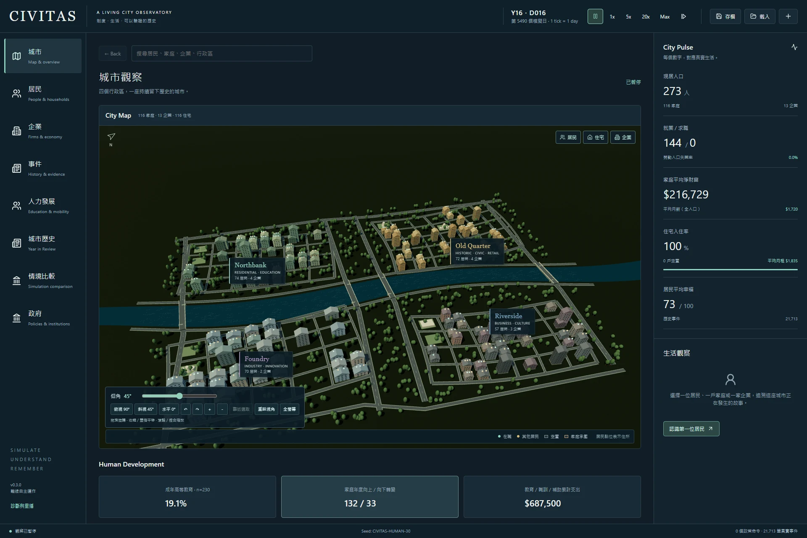
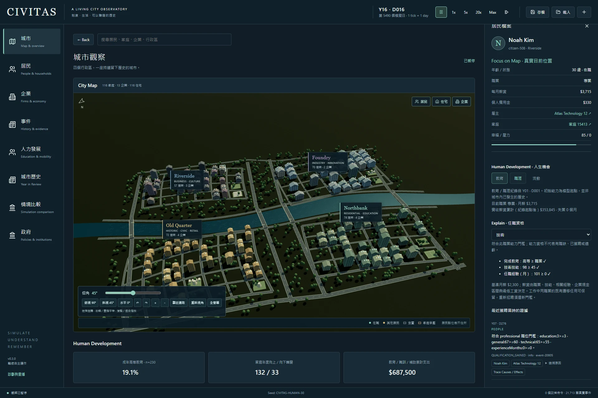
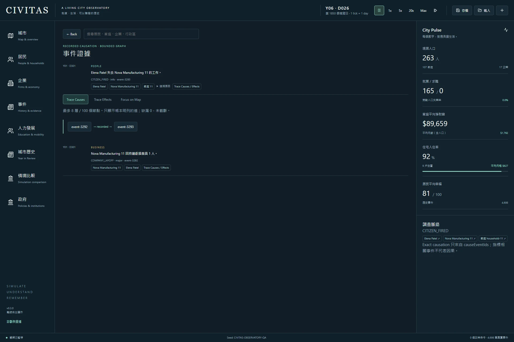
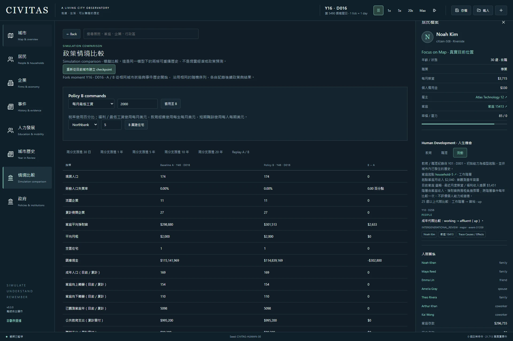
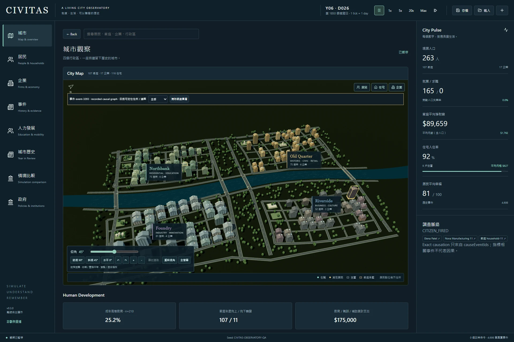
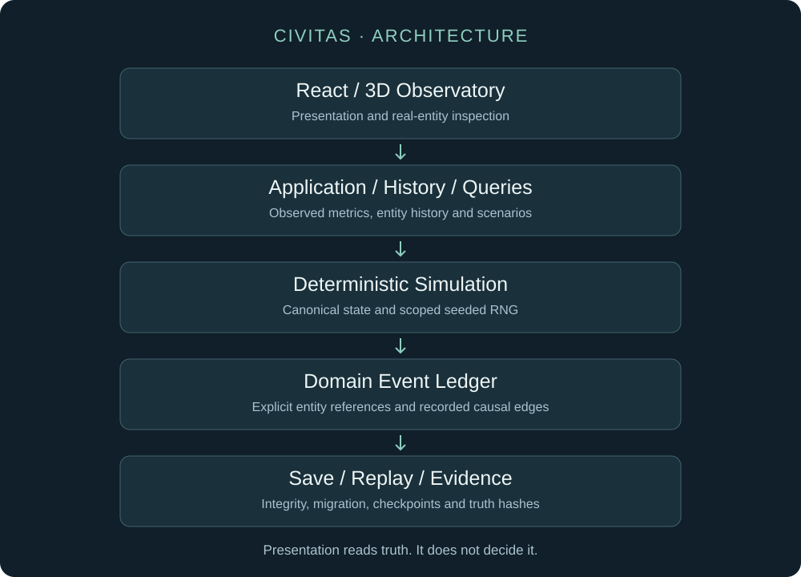

# Project CIVITAS

> **每一個統計數字背後，都有一段故事。**

**一座持續演化、可確定性重現的微型城市，以及探索市民生活的城市觀測站。**

Project CIVITAS 是一個確定性的城市社會模擬專案。數百名自主市民會在數十年的時間裡求學、工作、組成家庭、轉換職涯、改變社會階層，並回應公共政策。你可以追查數字背後的人：當失業率上升時，從已記錄的解僱事件找到相關公司、市民與家庭，再檢視事件的因果鏈。



[**觀看展示影片**](docs/media/civitas-demo.mp4) · [**Windows 穩定版下載 — v0.2.0**](https://github.com/oliverchenOVO/project-civitas/releases/tag/v0.2.0) · [**系統架構**](docs/ARCHITECTURE.md)

*截圖與影片展示目前的 Phase 2A／3D 開發版本，並非所有功能都已包含在穩定版 v0.2.0 中。GitHub 的 MP4 檔案頁可透過 Raw／View raw 取得影片。*

## 專案特色

- **確定性模擬：**相同的模擬版本、種子與指令歷史，可以重現相同的城市。
- **持續演化的市民生活：**目前開發版本涵蓋教育、技能、職涯、收入、家庭、住宅與社會流動。
- **可追查的因果紀錄：**統計 → 事件 → 公司 → 市民 → 家庭；明確區分已記錄的因果關係與一般關聯。
- **政策情境實驗：**將同一座城市分成獨立的 A／B 政策歷史，比較後續結果。
- **互動城市觀測站：**各版本提供 2D／3D 介面，讓你檢視真實存在於模擬中的實體。

## 為什麼做 CIVITAS？

多數城市模擬告訴你發生了什麼。CIVITAS 讓你進一步調查為什麼。

```text
失業率
    ↓
已記錄的解僱事件
    ↓
公司 → 市民 → 家庭
    ↓
已記錄的原因與後果
```

每個實體連結都會開啟實際的模擬實體。歷史數值來自已記錄的觀測與事件；缺少歷史時會顯示資料不可用，不會把一般關聯當作已證實的因果關係。

## 人力發展 — 目前 Phase 2A 候選版本

目前開發版本包含教育、技能、職業、升遷、薪資成長、家庭經濟階層、跨世代流動與教育政策實驗。市民的資格資訊會顯示實際的教育、技能與經驗門檻；童年觀測與 25 歲回顧紀錄則支援跨世代比較。



這些功能已實作，仍待桌面執行環境的最終驗收，**尚未包含在穩定版 v0.2.0 下載檔中**。

<details>
<summary>查看因果紀錄、情境比較與地圖證據</summary>







</details>

## 系統架構



模擬建立事實，敘事可以描述事實，但不能決定事實。大型語言模型（LLM）不參與決定模擬結果；目前應用程式使用確定性的事件模板，不需要 LLM 服務或 API 金鑰。

React 觀測介面查詢應用程式的歷史紀錄與實際領域實體。模擬核心負責權威狀態、分作用域的隨機數串流（RNG）與事件帳本。攝影機移動、示意地理配置與畫面渲染都不影響模擬的權威狀態。詳見[系統架構](docs/ARCHITECTURE.md)、[確定性設計](docs/DETERMINISM.md)與[存檔／重播](docs/SAVE_AND_REPLAY.md)。

## 工程驗證

專案包含種子驅動的執行、分作用域 RNG 串流、標準化狀態雜湊、確定性重播、完整性檢查與存檔遷移、情境檢查點、性質測試、長期模擬、Windows 打包，以及由模擬資料驅動的 3D 呈現。

**目前 Phase 2A 開發版本的驗證紀錄：**

| 驗證項目 | 已記錄結果 |
| --- | --- |
| 自動化正確性測試 | 110 項測試通過 |
| 穩定性 | 100 組種子 × 250 名市民 × 5 年；技術性失敗為零 |
| 持久化／重播 | 初始 250／1000 名市民 × 30 年，驗證儲存、載入、重播與續跑 |
| 人口壓力測試 | 初始 1000 名市民 × 100 年，驗證不變條件、持久化與重播 |
| 桌面版本發行驗收 | **仍受間歇性的原生程序關閉問題阻擋** |

上述數據屬於目前開發版本，不是穩定版 v0.2.0 的驗收數據。[公開驗證摘要](artifacts/README.md)保留精確的模擬狀態雜湊與限制；[Phase 2A 報告](docs/reports/PHASE2A_REPORT.md)分別記錄功能驗證成功與桌面驗收未通過的結果。

## 使用技術

TypeScript · React · Electron · Three.js · PixiJS · Zustand · Zod · Vitest · Playwright · pnpm

## 在本機執行

使用 Node 24 與 pnpm 11。相依套件版本鎖定於 `pnpm-lock.yaml`。

```bash
pnpm install --frozen-lockfile
pnpm typecheck
pnpm lint
pnpm test
pnpm build
```

執行 `pnpm dev` 可啟動瀏覽器觀測介面；完成建置後，執行 `pnpm desktop` 可啟動 Electron 應用程式。Windows 打包需要 Windows x64 與 PowerShell 7：

```bash
pnpm package:win
```

從目前 main 分支打包會產生**尚未通過最終驗收的開發候選版本**。若要使用已接受的穩定里程碑，請下載上方連結中的穩定版。

## 發行版本

### v0.2.0 — 觀測站、歷史與因果

**最新穩定版。**包含歷史指標、已記錄的因果調查、市民生命歷程、家庭／公司歷史、地圖證據、年度回顧、A／B 政策情境與 v2 存檔。

[發行說明與 Windows 下載](https://github.com/oliverchenOVO/project-civitas/releases/tag/v0.2.0) · [穩定版里程碑報告](docs/reports/PHASE1_1_REPORT.md)

目前開發內容為**人力發展與社會流動**，以及互動式 3D 呈現。尚未發布 v0.3.0 正式版或預覽版。

## 專案狀態

**持續開發中。**最新穩定里程碑為 **v0.2.0 — 觀測站、歷史與因果**。目前 main 分支進一步加入人力發展、教育、職涯、跨世代流動、更深入的人口行為與互動式 3D 城市呈現。Phase 2A 功能已實作，仍待桌面執行環境的最終驗收。

## 已知限制

CIVITAS 是持續開發中的研究型模擬專案，尚未達到正式商業遊戲的成熟程度。

- 人力發展模型採用刻意簡化的教育與職業分類。
- 長期人口行為雖已納入模擬，但尚未以真實城市資料進行校準。
- 3D 城市是確定性的示意視覺化，不是 GIS 地理資料。
- 在主要 Windows 開發機上，較重負載的 session 結束後，Electron 程序關閉偶爾會超過專案嚴格的 10 秒原生程序 QA 門檻；調查也在最小案例與冷啟動關閉的對照測試中記錄到間歇性失敗。
- 在已記錄的驗證中，模擬正確性、存檔完整性與確定性重播未受上述關閉問題影響。
- Windows 執行檔尚未簽署數位憑證。

工程細節請見[程序關閉調查結案報告](docs/reports/SHUTDOWN_CLOSURE_REPORT.md)。目前未宣稱已透過執行環境的替代方案解決此問題。

## 專案報告

[Phase 1](docs/reports/PHASE1_REPORT.md) · [場景重製](docs/reports/SCENE_REMASTER_REPORT.md) · [Phase 1.1／3D](docs/reports/PHASE1_1_REPORT.md) · [Phase 2A](docs/reports/PHASE2A_REPORT.md) · [公開發行稽核](docs/PUBLIC_RELEASE_AUDIT.md)

## 授權

Copyright © 2026 oliverchenOVO。保留所有權利。

本公開原始碼儲存庫僅供作品集與學術審閱使用。未經明確書面許可，不得修改、再散布、商業使用、再授權或製作衍生作品。本專案並非採用開源授權；第三方相依套件仍適用各自的授權條款。

請參閱 [LICENSE](LICENSE) 與[參與說明](CONTRIBUTING.md)。目前不接受外部功能貢獻。
