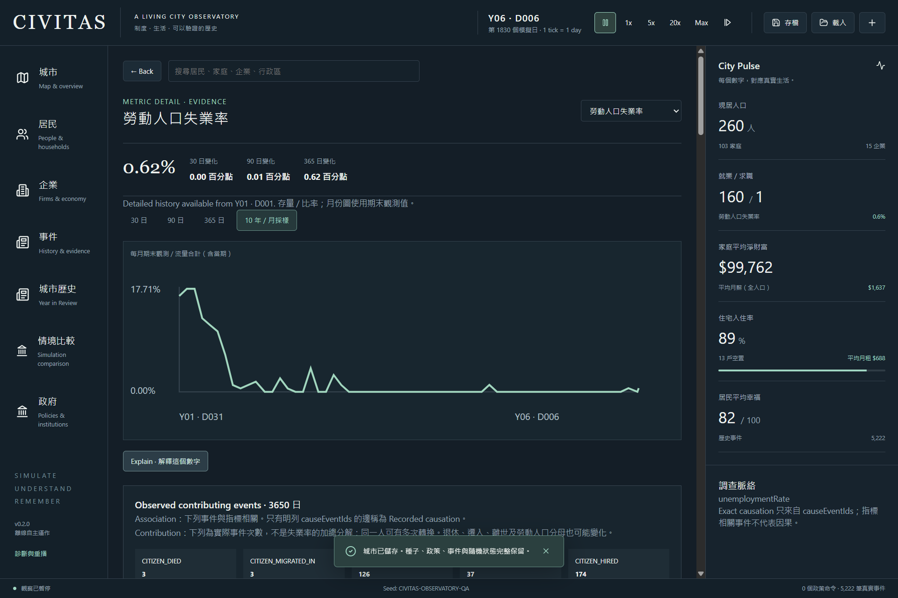
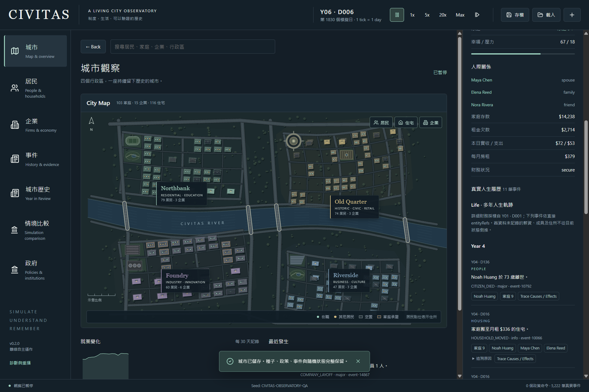
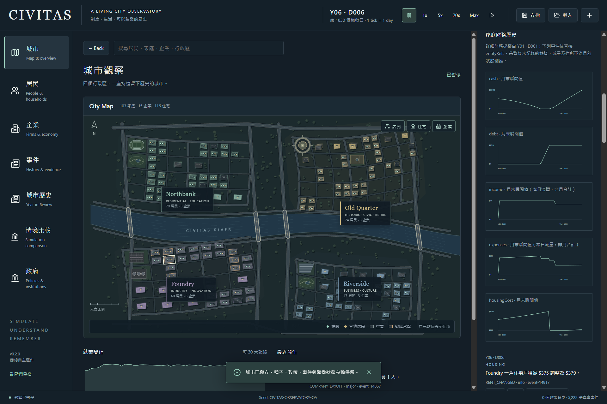
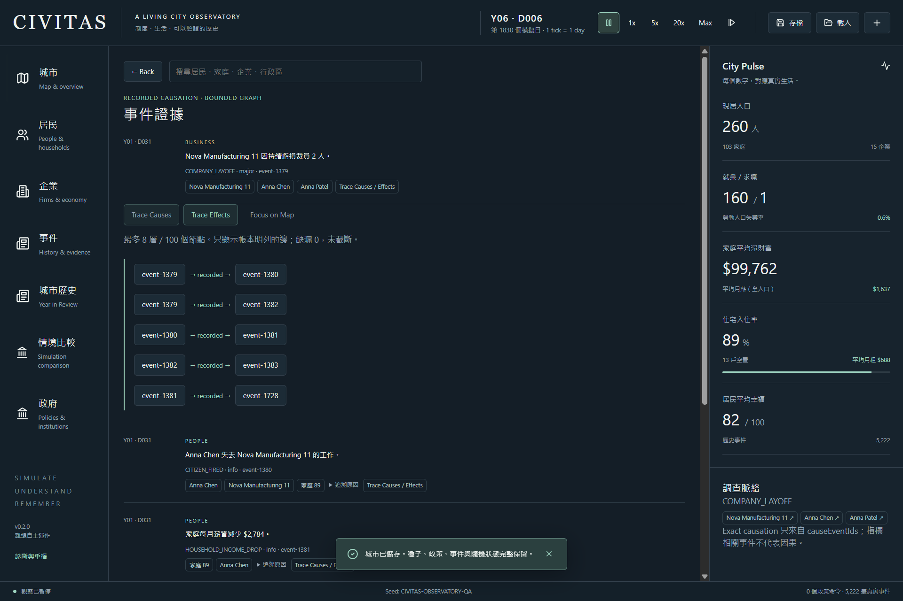
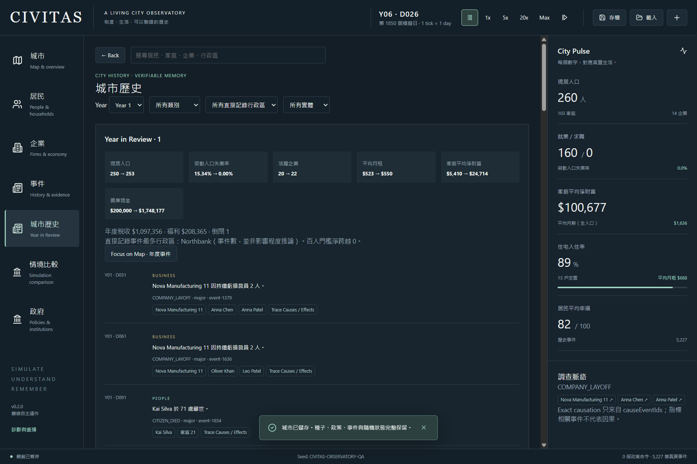
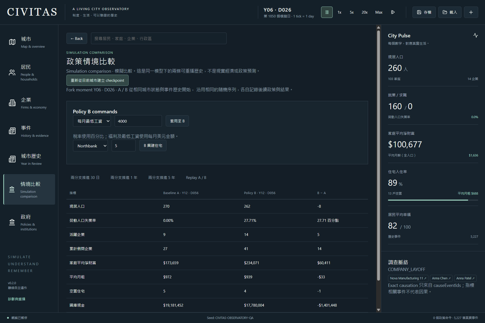

# Project CIVITAS — Phase 1.1: Observatory, History & Causality

Delivery: app **0.2.0**, simulation **0.1.0**, application save **2**. Phase 2 has not started. The simulation/domain/shared packages, existing scene layout, Electron main/preload and dependency lockfile are unchanged from Phase 1A baseline `e8520dbad64d2979336b1dd7005519b5ba4a560b`.

## Architecture and truth boundary

`packages/application/src/history.ts`, `queries.ts`, `scenarios.ts` and `save.ts` provide observations, indexes, queries and persistence above the original simulation. `CityState`, RNG, ID allocation, economic rules and the canonical simulation hash retain their original contracts. Advancing the controller captures compact observations after each real simulated day; observations never write into simulation truth. Commands at the same day refresh closing stocks without counting the day or its flows twice.

Presentation routes, search, selection, temporary map overlays and a bounded 50-context Back stack live in Zustand. Back preserves metric range/Explain state, history filters, selection, overlay and main/window/inspector scroll. They are presentation state, separate from the save's historical observations. Query results contain real event/entity references. No LLM, generated narrative, inferred activity or new simulation rule is involved.

## Metric history

The sidecar retains the initial observed point, at most **400 daily metric samples**, monthly periods, annual periods and monthly company/household snapshots. A period stores opening and closing stocks, integer sums/counts for means, and separate tax/welfare/bankruptcy flows. There is no full daily `CityState` clone. Monthly charts use closing stocks or accumulated flows; daily charts use actual samples. No interpolation is presented as observed history. Rate changes are labelled percentage points.

Observation periods contain days **1–365**, then 366–730, etc., with 12 presentation months per year: eleven 30-day months and one 35-day month. This is an observation calendar, not a change to the original 30-day economic budget rule. Year in Review compares the opening stock at day 0 with the closing stock at day 365 and sums days 1–365. The event list's Year filter follows the existing displayed dates (days 0–364 for Year 1); the review explicitly uses a completed elapsed 365-day observation period, so the closing boundary is one day later. Partial migrated years never masquerade as full annual reviews.

Company snapshots contain employees, observed revenue, payroll, profit and cash. Household snapshots contain cash, debt, observed income/expenses, housing cost and membership count. These financial fields are **instantaneous monthly observation points**, not invented monthly transaction totals. The existing event ledger is retained for life and financial evidence between observations.

Real century measurement: a city starting with 1000 people advanced 36,500 days. History grew from **6,824,970 bytes at 10 years** to **76,563,528 bytes at 100 years**, while daily retention stayed at 400. The final population was 104 and the ledger had 168,672 events; this is the existing model's outcome, not a claim of a stable real-world population. Compressed v2 save: **14,138,575 bytes**; simulation plus observation collection **16.89 s**, save **5.75 s**, load **7.07 s**. Truth/history round-trip, next-day continuation and compressed tamper rejection passed. The artifact's 1201 monthly/101 annual records include the additional continuation-test day; exactly 100 completed years have 1200/100 periods. [Century evidence](../artifacts/observatory-century.json).

## Indexes and causal queries

`EventIndex` incrementally maintains `byId`, `byEntity`, `byType`, `byCategory`, reverse causal effects and major-event lists. A replaced ledger on load/reset rebuilds indexes. Time ranges use binary search over chronological lists, with an exclusive start and inclusive end. Entity histories and event-category views avoid repeated full-ledger filters in React.

Trace Causes / Effects walks only recorded `causeEventIds`, with default **8 levels / 100 nodes**, explicit missing-reference and truncation results, visited-node/edge deduplication, cycle protection and deterministic ordering. All displayed edges retain cause → effect direction. A root without a predecessor displays **No recorded causal predecessor**. A related event alone never becomes a causal edge.

Metric explanations distinguish **Association** (related recorded events), **Contribution** (counts of actual transitions, not an additive rate decomposition), and **Recorded causation** (explicit ledger edges). Unemployment queries include firing/hiring/quitting/retirement/workforce and population transitions, expose actual citizens, group actual firing events by company, and link into the causal query. Repeated transitions are counted as events, not unique people. Denominator changes prevent treating those counts as a complete unemployment-rate attribution. Other Pulse metrics expose available relevant evidence without inventing causal coefficients.

## Citizen, household and company investigations

Citizen Life groups real indexed employment, household, residence, migration, birth/death and related events by year, with bounded pagination. It does not reconstruct an unrecorded historical employer or home from the current one. The current household link is bidirectional with actual member links. Household inspection shows current income, housing cost, cash, debt, employment context, monthly financial samples and recorded changes. Company inspection connects actual employees/finances, monthly employee/revenue/payroll/profit/cash trends, layoffs and bankruptcy evidence. Search accepts actual names or IDs for citizens, households, companies and districts, returning at most 30 results.

## Map evidence and visual quality

Focus on Map preserves the investigation context and resolves real company footprints, household residences, citizen known residences and recorded districts through the existing scene data. A retained Graphics layer highlights deduplicated affected parcels and can filter companies, households or residents. Clear removes the temporary investigation layer. Dead, migrated or otherwise unlocated references receive no fictional position. A historical reference focuses its **currently locatable** address, explicitly labelled in the UI; this is not a historical location reconstruction.

The Phase 1A river/bridges/streets/district geometry and all original layer/hover/click behavior remain intact. Native tests cover 1536×1024 and 1280×800; responsive tests cover 390×844 with no body overflow. Final screenshots are actual rendered application captures, inspected as local images. An attempted interactive IAB rebind after interruption was rejected by browser policy; no workaround was attempted. Packaged native QA and the explicitly requested responsive automation independently provide the recorded evidence.

[Recorded metric evidence](design/phase1-1-evidence.png).

[1000-person affected scene](design/phase1-1-map-1000.png) · [390×844 metric detail](design/phase1-1-mobile.png).

## City History and Year in Review

History filters by year, category, directly recorded district reference and entity type. Importance is a deterministic function of recorded severity, policy changes, unique referenced entities, recorded worker impact, bounded financial magnitudes and population transitions. It never uses a present-day residence to fabricate an old district association. Annual review requires a complete observed 365-day period, shows opening/closing metrics, tax/welfare/bankruptcy flows, net hundred-person milestone crossings and ranked real events. “Most recorded district” means event count, not a causal ranking of damage. Review events link back to recorded causal evidence and the map.

## Scenario checkpoint and replay

Fork creates one explicit checkpoint and two isolated city/history branches. Full states are cloned at this deliberate fork, not every tick. Branch B accepts existing tax, welfare, minimum-wage and funded housing commands. A retains baseline policy. Each branch owns RNG state, counters, command ledger and observations. The UI advances both by 30 days, one year or five years in 30-day chunks that yield to rendering, displays actual metric differences and post-fork cumulative taxes, and labels the result a **simulation comparison**.

Both branches verify a full truth replay and an observation replay from the checkpoint with post-fork commands. The original city remains independent. Checkpoint, original observations, both branch states/history and policy ledgers survive native save, normal close, relaunch and reload. QA executes all three durations cumulatively (2220 days per branch), then verifies both branches again after reload. It is not a forecast or causal estimate about the real world.

## Save v2 migration and integrity

The application writes a strict saveVersion 2 envelope containing original `state`, `history`, nullable scenario workspace and a manifest. `simulationTruthHash` hashes only the original `CityState`. `containerIntegrityHash` hashes the logical body, including observations and scenarios. Compression changes encoding, not either hash contract. Bodies above 1 MB use gzip/base64; smaller bodies remain readable JSON. Native encoded file-size bounds remain 100 MB, and expanded compressed input is bounded at 500 MB. Loading validates strict schemas, chronology/availability, entity IDs, scenario command lineage, simulation invariants and both hashes before publication.

The migration table's v1 handler uses the unchanged simulation loader and initializes detailed observations at the saved day. Earlier events remain queryable, but older metric samples are **unavailable**, never backfilled from today's state. UI deltas and incomplete annual reviews say so. Existing simulation `saveCity/loadCity` primitives remain v1 for baseline compatibility; the app controller uses `saveObservatory/loadObservatory`. Unknown future versions are rejected. No index is persisted; indexes are rebuilt from the verified ledger.

## Tests and performance

| Gate | Result |
|---|---|
| TypeScript / ESLint | Passed |
| Automated tests | **89/89**: 27 simulation, 9 architecture, 8 scene, 13 observatory, 32 generated policy sequences |
| Recorded graph cases | Direct/multiple cause, missing refs, cycle/depth/node bounds, deduplication and stable ordering passed |
| History/persistence cases | Same-day dedup, stock/flow calendar, truth/RNG immutability, continuation/replay, v1 boundary, incomplete annual review and compact century capacity passed |
| Scenario cases | Original/A/B isolation, policy divergence, truth/history replay and persistence passed |
| Property tests | 32 fixed xorshift seeds × 24 valid policy/construction commands; integer/money/reference/dead-worker invariants, save continuation and replay passed |
| Canonical regression | All four 10-year hashes unchanged; no invariant violations |
| Stability | 100 seeds, zero technical failures; all 100 hashes unchanged |
| Fresh packed payload | All **13** renderer/main/preload files byte-match fresh build |
| Native observatory QA | **12 checks**, no console errors; five-year history, all investigation journeys, scenario reload/replay and migration |
| Scene QA | **11 checks**, no console errors, including real 1000-person affected overlay CPU measurements |
| Existing desktop QA | **13 checks passed**, no console errors, including original save/continuation/UI replay |
| Windows package | Portable and unpacked 0.2.0 built; Electron 38.8.6 / Chromium 140.0.7339.249 / Node 22.22.0 retained |
| Strict native normal-close gate | **6/6 passed**, all owned processes absent within 10 s, no force cleanup |

Property failures report the seed and command sequence for reproduction; this is bounded deterministic generation, not an exhaustive state-space proof. [Property results](../artifacts/property-tests.json), [observatory QA](../artifacts/observatory-qa.json), [scene QA](../artifacts/phase1-1-scene-qa.json), [desktop QA](../artifacts/desktop-qa.json), [packed/hash regression](../artifacts/observatory-regression.json), [stability](../artifacts/stability.json).

The unchanged simulation's 100/250/500/1000-person 10-year benchmark took **271 / 455 / 973 / 3142 ms** respectively. Runtime variation is not attributed to a new economic rule. [Benchmark](../artifacts/benchmark.json).

| Initial population | Unchanged final canonical SHA-256 |
|---|---|
| 100 | `0e21ceef932e7a465b235cd1155562a87bf2054ce7b1ae51df6c83025913ae51` |
| 250 | `1997a1eb7452025de74d2a5b63e8167ec952e63b0e2617c24a29cbeebbece1cd` |
| 500 | `13fea6a3e754d0c3c362a76338663a5f10aa91934d552ca8d007a2b14d95ffb7` |
| 1000 | `c28b6aaa82ee4f927b07a0a09a32ee1ad8cffbd8c6c228beb4452717607a1ee8` |

Separate 1000-person/10-year observation query benchmark: 30,543 events; collection **1821.04 ms**, index build **40.08 ms**, history **6,867,105 bytes**. Each query repeated 100 times:

| CPU operation | Mean ms | P95 ms |
|---|---:|---:|
| Bounded recorded causal query | 0.00446 | 0.00650 |
| Indexed ten-year citizen history | 0.00061 | 0.00090 |
| 90-day metric explanation | 0.03613 | 0.04710 |
| Entity name/ID search | 0.37962 | 0.44000 |
| Base scene data projection | 3.37166 | 3.65180 |
| 300-reference affected parcel projection | 0.40372 | 0.42000 |

These are measured representative Node queries, not worst-case latency promises. [Query evidence](../artifacts/observatory-benchmark.json). Native packaged scene, 20 updates per phase: base **10.295 ms**, affected layer alone **1.080 ms**, base plus affected **10.765 ms**. Base uses days 1–20; the affected phase uses actual recorded unemployment-related references after an observed year, so it is not a same-day A/B timing experiment. CPU timings exclude GPU rasterization and are not FPS.

## Native exit and QA corrections

Final [WM_CLOSE acceptance](../artifacts/observatory-native-close-qa.json), `2026-10-03T15:04:20Z`: unpacked kernel upper bounds **705 / 680 / 616 ms**, final CIM absence **2680 / 2454 / 2631 ms**; portable kernel upper bounds **2693 / 4626 / 3058 ms**, final CIM absence **4139 / 6313 / 4234 ms**. All six main/wrapper/renderer/GPU/utility ownership closures exited voluntarily; identity queries returned zero remaining processes after observer handles were released. Raw process observations remain in local `artifacts/qa/exit-observatory-acceptance-*`.

The original kernel polling/CIM identity harness and 10-second deadline are unchanged. A force kill cannot count as success. Phase 1A's historical sporadic portable latency and its unproven root cause remain documented in [the earlier report](SCENE_REMASTER_REPORT.md); this bounded gate does not establish that every contended environment is fixed.

Two intermediate test failures are preserved transparently. The interrupted preview service caused `ERR_CONNECTION_REFUSED` only at responsive QA after eleven native checks; it was restarted and the complete final workflow passed. Existing desktop QA initially read the prior save because its old success toast was still visible; the harness now dismisses that prior notice before waiting for the new native save completion. The mismatch was not accepted or hidden. [Preview failure](../artifacts/observatory-qa-preview-interruption.json), [stale-notice failure](../artifacts/observatory-desktop-qa-stale-notice.json). The causal-row selector was also narrowed to the event's own ID rather than any descendant cause reference, and the final real-company cause/effects workflow passed.

## Delivery, Git and release

Local portable: `release/0.2.0/CIVITAS-0.2.0-Windows-portable.exe`, **85,643,947 bytes**, SHA-256 **`f8d4974482ff0ee77bccc206e2ce452cadd6ced34009681c42739ed84552f697`**. Unpacked entry: `release/0.2.0/win-unpacked/Project CIVITAS.exe`; keep its companion files.

Phase 1A's 0.1.1 artifact remains unchanged: SHA-256 `17428f1a1698870f2bf2cbd42073ea293e3390a395b25efff0b4eca879a3068d`. Existing immutable tags `v0.1.0` and `v0.1.0-rc.1` and the prior GitHub release remain untouched. Version 0.2.0 was chosen after the actual feature scope was implemented. The completed delivery is tagged **v0.2.0 locally**. No new GitHub release or remote tag is published in this delivery; the tested Windows executable is local. This preserves the existing remote release and avoids claiming unrun remote CI results.

Implementation commits include `ccc68ad` (history/index/scenarios), `ea6fa72` (compressed v2), `41f43c9` (investigations), `0416cfc` (map evidence), `7200d0b` (Back context). Final implementation and gate commit: **`65b4e45f79394e8eebbd6282caa52a657a95e219`**. Final delivery commit (including this report and its screenshots): **`v0.2.0^{commit}`**, resolved with `git rev-parse "v0.2.0^{commit}"`; a report cannot embed its own commit SHA without changing that SHA. The working tree is checked clean after the delivery commit/tag. Commits and the new tag remain local; no push or GitHub publication is claimed.

Reproduce with `pnpm typecheck`, `pnpm lint`, `pnpm test`, `pnpm benchmark`, `pnpm stability`, `pnpm benchmark:observatory`, `pnpm exec tsx scripts/observatory-longrun.ts`, `pnpm package:win`, then a production preview at 4173 and `pnpm qa:desktop`, `pnpm qa:scene`, `pnpm qa:observatory`. Normal close: `pwsh -NoProfile -File scripts/native-close-qa.ps1 -AppVersion 0.2.0 -Repetitions 3 -CasePrefix observatory-acceptance -ReportName observatory-native-close-qa.json`.

## Known limits and six product questions

Daily detail older than 400 days is represented by monthly/annual observations; old exact daily metric reconstruction requires replay. Individual finances are monthly instantaneous samples plus events, not a transaction-complete accounting history. Current map locations do not establish past residences or hourly activity. District filters use recorded references, so events without those references cannot be geographically attributed. Importance is a fixed explicit ranking, not a subjective or causal impact score. Some non-Pulse metric queries use broad associated ledger evidence. Replays, hashing and large save validation can briefly occupy the renderer; there are no new persistent workers or background timers. A fork deliberately duplicates full checkpoint/branch states, and the century-size result measures one city, not three concurrent century branches. Encoded/expanded input bounds are finite. There is no historical simulation-version migration beyond supported v1, undoable simulation timeline, GIS, traffic, API/LLM narrative, signing certificate, cross-platform GUI claim or Phase 2 subsystem.

| Required product question | Verified journey |
|---|---|
| Find real people who lost jobs? | Unemployment Explain → recorded CITIZEN_FIRED → actual citizen |
| Find related companies and events? | Recorded company grouping → company finances/history → actual layoff/bankruptcy event |
| See several years of real life? | Five-year native history → search citizen ID → year-grouped Life and household links |
| Follow recorded causes/effects? | Actual company root → bounded causes/effects → explicit directed edges |
| Return from history to real map positions? | Company focus, causal affected layer and annual event overlay → current known locations → Back context |
| Compare two deterministic policy histories? | Shared checkpoint → B minimum wage → 30/365/1825-day runs → both replay → normal close/reload/replay |

All six journeys are verified: **PHASE 1.1 COMPLETE**.

## Post Phase 1.1: 3D city presentation, local 0.2.1

The requested ground-parallel to perpendicular camera is implemented in the existing desktop application. Three.js 0.186.1 replaces the active flat renderer with a perspective WebGL scene: actual parcel buildings have deterministic body heights, pitched roofs, facade windows and foundations; bridges have raised decks, rails and piers; roads, river, trees, shadows and district landmarks provide depth. The supplied city illustration guides the palette and district identity. This is procedural city massing, with the existing street layout and actual population density; it does not yet reproduce the illustration's organic streets or landmark art quality.

Camera elevation is continuous **0°–90°** with three preset buttons, full azimuth rotation, zoom, pan, selection focus and reset. Drag rotates, right drag pans and wheel zooms; touch uses OrbitControls gestures. Focused canvas supports arrows, +/− and R. Fullscreen has an explicit exit button and Escape handler. Back restores the target and camera alongside the investigation context. Raycasting opens actual resident/company IDs; hidden layers do not leave their facade decorations visible.

Building heights, trees and landmarks are presentation only. Resident markers identify current recorded addresses, not pedestrians. No simulation/domain/application/shared rule or original parcel-layout source changed. Camera actions, selection, layers and fullscreen preserve a native saved canonical city hash. No building floor counts, traffic, GIS, past addresses or new simulation actors are inferred from this view.

The renderer uses instanced buildings/resident markers and merged static geometry. Rendering is demand-driven with a coalesced animation-frame request; orbit damping is disabled. Unmount cancels the frame, disconnects resize observation, removes listeners, disposes controls/geometries/materials/textures/shadows and the WebGL renderer. Visual randomization does not use simulation RNG. The two new endpoint/massing tests exercise full camera orbits and canonical state isolation.

| Validation on the final 0.2.1 package | Result |
|---|---|
| Typecheck / lint / unit and integration tests | Passed; **91 tests** |
| Native 3D scene and responsive QA | **9 checks passed**, zero console errors; actual 90°/45°/0° screenshots, raycast selection and saved-truth isolation |
| Existing desktop journeys | **13 passed**, including save, continuation and replay |
| Observatory journeys | **12 passed**, including life/history/causality/affected map and A/B scenarios |
| Fresh packed payload | **6 files** byte-match final renderer/main/preload build |
| Retained canonical baseline artifacts | All four ten-year hashes and 100 seed hashes still match; the simulation source is unchanged. The long-run benchmark/stability sweep was not rerun for this visual-only change |
| Native 1000-person scene, 20 days | Mean CPU data/instance/overlay update **6.12 ms**, **22 draw calls**; excludes GPU time and is not an FPS measurement |
| Strict native WM_CLOSE gate | **Not passed**; see the exit evidence below |

Browser plugin was unavailable; testing used the project's native Playwright Electron harness plus Edge responsive checks. Evidence: [3D QA](../artifacts/scene-3d-qa.json), [desktop QA](../artifacts/desktop-qa.json), [observatory QA](../artifacts/observatory-qa.json), [payload/baseline comparison](../artifacts/scene-3d-regression.json). The older 0.2.0 evidence is preserved at `v0.2.0`.

Two intermediate UI failures remain recorded: an early hover test used projected coordinates before the demanded frame rendered; the harness now waits for a new frame and chooses a canvas target unobscured by controls. Fullscreen Escape initially did not exit in packaged Electron; the explicit application handler fixed it and the final complete scene QA passed. [Initial selection evidence](../artifacts/scene-3d-qa-initial.json), [fullscreen evidence](../artifacts/scene-3d-qa-fullscreen.json).

The native close investigation must **not** be reported as 6/6 accepted. In the [first six-run gate](../artifacts/scene-3d-native-close-qa-initial.json), all processes exited voluntarily, but one portable final identity-absence check completed at **11,117 ms**, outside the strict ten-second gate (kernel exit at 9,077 ms). A [confirmation run](../artifacts/scene-3d-native-close-qa.json) passed all three unpacked cases and two of three portable cases; portable case 2 still had its wrapper, main and GPU process observed at timeout and required separate test-owned cleanup. That case is a failure and cleanup is not counted as success. No deadline was relaxed, and no lifecycle workaround was added. This confirms the previously documented sporadic portable latency remains unresolved; it does not establish a Three.js root cause. The unpacked executable is the recommended entry for this local delivery. Raw observations are retained in `artifacts/qa/exit-spatial-acceptance-*` and `exit-spatial-confirmation-*` locally.

Verified screenshots: [90° top](design/scene-3d-top.png), [45° oblique](design/scene-3d-oblique.png), [0° horizontal](design/scene-3d-horizontal.png), [1000 residents](design/scene-3d-city-1000.png), [fullscreen](design/scene-3d-fullscreen.png), [390×844 mobile](design/scene-3d-mobile.png).

Local portable `release/0.2.1/CIVITAS-0.2.1-Windows-portable.exe`: **85,639,586 bytes**, SHA-256 `37b7b33984084eab4b2ea5db508994194229a7dfabe1adf92782e02800d9f5aa`. Unpacked entry `release/0.2.1/win-unpacked/Project CIVITAS.exe` needs its companion folder. Electron 38.8.6 / Chromium 140.0.7339.249 / Node 22.22.0 remain unchanged. The 0.2.0 portable still has SHA-256 `f8d4974482ff0ee77bccc206e2ce452cadd6ced34009681c42739ed84552f697`. No new remote release or push is claimed. The local 3D delivery is tracked by `v0.2.1`; its stricter portable exit limitation is recorded above.
