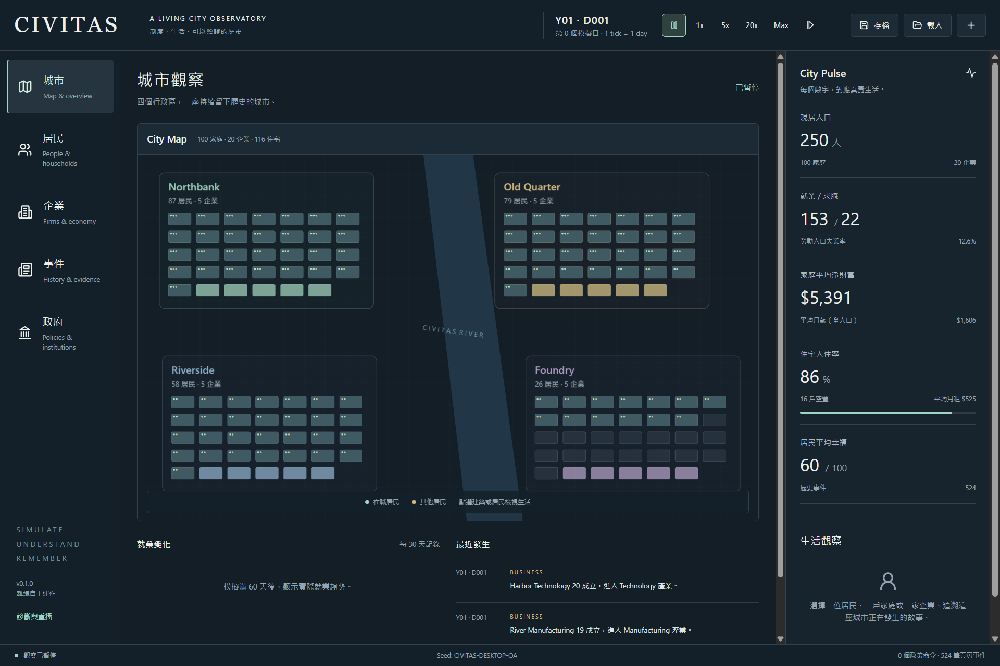
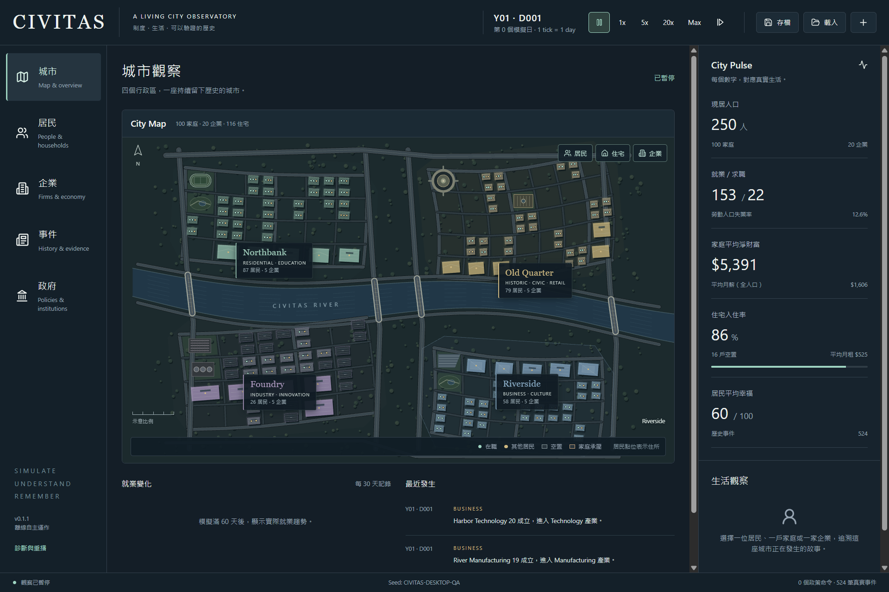

# Project CIVITAS — Phase 1A Scene Modeling Remaster

Baseline: `deec84edd26d543c501a65bb36b794cc7ceaf2f8` / immutable `v0.1.0`. Application version: **0.1.1**. Simulation/save schema version remains **0.1.0**. Phase 1.1 and Phase 2 have not started. No new release candidate or GitHub release was created.

**PHASE 1A COMPLETE** — visual, data, interaction, packaging and final native exit acceptance passed. Earlier exit failures remain disclosed below; this is a measured acceptance result, not a claim that sporadic shutdown latency has a proven cause or can never recur.

## Goals and result

Rebuilt the central Pixi map as a continuous miniature city: variable-width river, four bridge/arterial connections, riverbank roads, neighborhood streets, block subdivisions, entity parcels and roof masses. Districts share terrain; district colors no longer outline dashboard boxes. Existing navigation, toolbar and City Pulse remain.

This is procedural presentation of simulation entities. The generated [detail concept](design/scene-remaster-concept.png) and original [shell concept](design/observatory-concept.png) are references only; neither is loaded by the application. No raster backdrop, invented residents, fake statistics, new economy, traffic system, Unity or Blender dependency was introduced.

## Architecture and modeling rules

| File | Responsibility |
|---|---|
| `apps/desktop/src/scene/layout.ts` | Pure deterministic geography, district street/block/parcel geometry and actual Building ID placement |
| `apps/desktop/src/scene/data.ts` | Indexed real occupancy, housing condition, firm status, district totals and resident residence projection |
| `apps/desktop/src/scene/renderer.ts` | Retained terrain/roads/anchors, batched building/resident overlays, hit testing and selection |
| `apps/desktop/src/components/CityMap.tsx` | Pixi lifecycle/cleanup, resize transform, DOM label plates, layer controls and legend |
| `apps/desktop/src/components/Inspector.tsx` | Actual district/entity details and links |

World coordinates are normalized to 1000×650. Presentation-only seed hashing uses config, district IDs and building IDs; it never consumes simulation RNG or mutates CityState. Initial population sets street grain. Seed-ranked parcels give stable placement: day, employment, occupancy, resize and selection do not move existing entities. Additional housing occupies subsequent deterministic slots. Save/load and replay reconstruct identical geometry.

Static terrain, water, trees, streets, bridge connections and anchors are retained across daily updates. Data overlays use O(n) indexed projection and batched Graphics. Pixi's continuous ticker is disabled; updates, resize and pointer interaction explicitly render. DPR is capped at 2.

| District | Spatial identity | Two presentation anchors |
|---|---|---|
| Northbank | Green residential grain, small pitched roofs and educational landscape style | Field and garden |
| Old Quarter | Denser, angled warm stone grain with civic/retail style | Roundabout/plaza and market court |
| Foundry | Larger industrial parcels, shed ridges and service landscape | Yard and utility forms |
| Riverside | Blue modern roof planes, commercial courts and waterfront character | Waterfront steps and park |

Anchors have no fabricated entity IDs or gameplay effects. Identity tags describe visual style, not new simulated services. Every housing/company roof mass maps to an actual building. Undeveloped parcels stay open landscape.

## Data and interaction truth

- Resident dots represent alive citizens with an actual known residence. Employment determines mint/gold color; it does not establish at-work, at-home or in-transit activity. Unlocated citizens are counted explicitly and receive no fabricated position.
- Housing occupancy derives from actual units and households. Empty housing uses dark roofs/outline; debt or nonsecure tenure uses a warm stress outline. Firms reflect actual active/bankrupt state.
- District counts derive from real residents and active firms. District plates/ground select the real district; residents, household residences and company footprints open their actual inspectors. Selection outlines actual footprints and highlights the selected entity.
- Resident, housing and company controls change visible canvas layers without changing state. Hover exposes actual identity/status. A north arrow, named river and schematic scale provide orientation without inventing meters.

## Before/after screenshots and final visual review

Main controlled comparison: seed `CIVITAS-DESKTOP-QA`, 250 initial residents, day 0, logical 1536×1024. Native capture is 1920×1280 because Windows DPI is 125%.

Before:

After:

Additional final captures: [1280×800](design/scene-after-1280.png), [1000 residents at 1280×800](design/scene-after-1000-1280.png), [390×844 responsive](design/scene-after-mobile.png). All are actual rendered application screenshots. Other before/interaction captures remain in local `artifacts/qa/scene-remaster/`. Old 1280/1000 captures use different day/seed, so they are visual history rather than controlled numeric comparisons.

Original and generated references plus all four final viewport screenshots were inspected together in the final QA pass. The final scene visibly reads as connected geography with identifiable neighborhoods, rather than four isolated widgets.

| Fidelity point | Final evidence / deliberate difference |
|---|---|
| River and bridges | Continuous curved river, width variation, texture and four crossings; no decorative boats implying transport |
| Street hierarchy | Broad arterial shoulders, thinner local streets, riverbank roads and junctions |
| Urban grain | Distinct block sizes/angles and roof treatments; lower density at 250 is truthful to actual building count |
| District identity | Four actual names, colored anchored plates, descriptor tags and two visual anchors each |
| Data overlays | Actual address dots, occupancy/stress encoding and clickable entity outlines; no fictional activity schedules |
| Palette/depth | Existing dark civic shell, green terrain, muted water, offset shadows and roof planes; code-native vector rendering rather than photorealism |
| Typography/copy | Existing shell fonts and Lucide controls; desktop names 15px, mobile names 12px; no concept-only facility names or invented physical distances |
| Responsive | 1536/1280 desktop containment; mobile name-only plates and compact height preserve overview/control legibility |

Copy audit: shipped names/counts/hover details are state-derived. Added map copy is the four style tags, CIVITAS RIVER, N, schematic-scale label, layer controls and condition legend. Concept-only fictional campus/cathedral/theater names, boats, transit and real-distance claims were intentionally omitted. Mobile hides tags/counts on the plates; actual district details remain in the inspector.

## Regression and performance

| Check | Result |
|---|---|
| Typecheck / lint | Passed |
| Tests | 44/44 (27 simulation, 9 architecture, 8 new scene integration) |
| Scene determinism | Save/load/replay geometry, RNG/state immutability, stable growth placement and 100/250/500/1000 entity coverage passed |
| Benchmark | Four 10-year canonical hashes unchanged; zero invariant violations |
| Stability | 100 seeds, zero technical failures; all canonical hashes unchanged |
| Build / Windows packaging | Passed; Electron 38.8.6 / Chromium 140.0.7339.249 / Node 22.22.0 retained |
| Fresh packed payload | All 13 renderer/main/preload files byte-match the fresh build |
| Desktop QA | 13 checks passed, zero console errors; native save/load/replay retained |
| Map QA | 10 checks passed: counts, selection/hover, actual canvas layer changes, highlights, three viewport widths, 1000-resident updates, normal shutdown |
| Native WM_CLOSE gate | Final fresh batch 6/6 passed, no force cleanup; final CIM absence 1469–7414 ms |

Core/domain/economy/save/replay files, Electron main/preload and dependency lockfile are unchanged from the Phase 1 baseline. Packaged save hash remains `9a3d773536cffa3ac9c58db25500cb9ecb730bc002fcceef80038267957b5956`. Full reports: [desktop](../artifacts/desktop-qa.json), [scene](../artifacts/scene-qa.json), [benchmark](../artifacts/benchmark.json), [payload/hash regression](../artifacts/scene-regression.json).

Final packaged 1000-resident daily presentation updates averaged **17.775 ms** over 20 days. This CPU measurement includes indexed data projection and Graphics command construction, excludes GPU rasterization, and is not an FPS guarantee.

The initial 1000-resident CLI benchmark was 4528 ms versus baseline 3581 ms, prompting three additional measured runs: **3690 / 3778 / 4450 ms**, median **3778 ms (+5.5%)**. The CLI does not load the scene renderer and core files are unchanged. Timing spread is reported rather than attributed to an unproven cause. Latest benchmark artifact is the 4450 ms run; [three repeats](../artifacts/scene-benchmark-repeats.json) are preserved. No broad performance conclusion is based on a single timing sample.

## Native exit investigation

The first remaster acceptance batch passed unpacked 3/3; portable 1/3 established the strict deadline. The other two portable runs were first observed absent at 11291/11304 ms, with final CIM absence at 12701/12823 ms. No forced cleanup occurred in that initial batch. These are failed acceptance observations, not proof of an exit time within 10 seconds. The result is preserved in [initial exit QA](../artifacts/scene-native-close-initial-qa.json).

One-second full CIM polling then produced long observation durations and failed runs requiring test-owned cleanup. Those results must not be counted as passes: [dense batch](../artifacts/scene-native-close-dense-qa.json). A first kernel-polling batch still failed because portable run 1 completed its absence checks late: [kernel initial batch](../artifacts/scene-native-close-kernel-initial-qa.json). A contemporaneous unchanged v0.1.0 control also failed the portable deadline: [baseline control](../artifacts/scene-baseline-native-close-qa.json). This does not prove the cause; it prevents attributing the delay solely to the remaster.

Final acceptance uses kernel process-handle polling at 50 ms intervals followed by targeted CIM queries over owned PID/parent closure, repeating discovery for late descendants, and identity checks after releasing observer handles. This avoids repeatedly enumerating unrelated machine processes during shutdown. The historical full-machine long-run sampling schedule remains available. A late observation still fails; the 10-second deadline is unchanged. No production shutdown handler, GPU setting or runtime version was changed.

Final fresh [native acceptance](../artifacts/scene-native-close-qa.json): **6/6 passed**, measured at `2026-10-03T13:07:55Z`. Unpacked kernel upper bounds: 573/566/381 ms; final CIM absence: 2259/1941/1469 ms. Portable kernel upper bounds: 4598/2981/5962 ms; final CIM absence: 6814/5061/7414 ms. All owned main/wrapper/renderer/GPU/utility processes exited, all identity queries returned zero remaining rows, and none of these six passing runs used force cleanup. Raw samples remain in local `artifacts/qa/exit-scene-owned-acceptance-*`.

## Build delivery and limitations

Local portable: `release/0.1.1/CIVITAS-0.1.1-Windows-portable.exe`, **85,634,111 bytes**, SHA-256 `17428f1a1698870f2bf2cbd42073ea293e3390a395b25efff0b4eca879a3068d`. Existing `v0.1.0` and `v0.1.0-rc.1` tags/releases are untouched. Older unused build chunks were moved to an ignored recoverable artifact directory before the final clean build; the shipped ASAR contains the fresh payload.

Limitations: this is a 2D schematic, not GIS or measured transport geography. District topology is a shared template; seed varies local street shape and entity parcels. Visual anchors do not simulate services. No hourly activity, transit, traffic, full 3D or new Phase 1.1 subsystem. Mobile supports overview and district selection; tiny entity picking uses existing lists, with no zoom/pan. Extremely large housing expansion may crowd parcels; tested population range is 100–1000. GPU timing/long continuous mobile gameplay is not claimed by the CPU update test. Sporadic native shutdown latency occurred in both old/new portable observations; the fresh strict batch passes, but the underlying historical/contended-case cause remains unproven.
